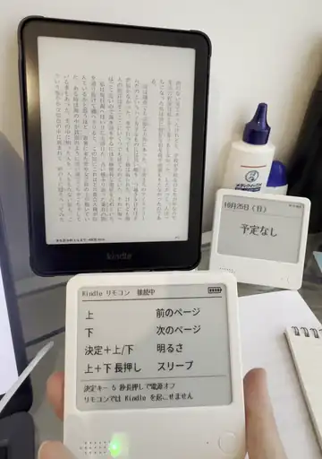

# NOTE4 Kindle Page Turner

**Turn pages on your Kindle without touching it.**

This firmware turns a ZECTRIX NOTE4 into a Bluetooth page turner. Your Kindle recognizes it as
Amazon's own Kindle Click remote, so there's no jailbreak and nothing to install on the Kindle.
Just pair it and read.

## Get started

1. Install the firmware on your NOTE4. See the [installation guide](docs/INSTALL.md).
2. On your Kindle, go to **Settings › Wi-Fi & Bluetooth › Bluetooth Devices** and pick **Kindle Click**.
3. When the NOTE4's LED stays on, you're connected. It reconnects on its own from then on.

## Buttons

| To… | Do this |
|---|---|
| Turn the page forward / back | Press **Down** / **Up** |
| Make the frontlight brighter / dimmer | Hold **OK** and press **Up** / **Down** |
| Put the Kindle to sleep | Hold **Up** and **Down** for 1 second |
| Turn the remote on / off | Press **OK** / hold **OK** for 5 seconds |

The remote doesn't turn itself off, so switch it off when you're done reading.

## Compatibility

Tested on Kindle Paperwhite (12th generation) with Kindle firmware **5.20.1.0.2**. Keep your Kindle
up to date: on older firmware, the Kindle goes to sleep on its usual timer even while you're turning
pages. Tried it on another model? [Let us know](../../issues).

## Don't have a NOTE4?

### Buy one ready-made

- **[HQB Market](https://hqb.market/collections/kindle-page-turners)** (our store): Zhilian Zongwei (智联纵维) remotes from $10. Ships to the US, CA, AU and NZ.
- **[Hanlinyue (翰林阅)](https://hanlinyue.com.cn/)**: e-readers and page turners, also on AliExpress in some regions.

### Build one yourself

These open-source projects also make a device act as a Kindle Click remote, so they work on a
Kindle without a jailbreak:

| Project | Runs on | Good to know |
|---|---|---|
| [Open-Kindle-Click-nRF52840](https://github.com/zuyan9/Open-Kindle-Click-nRF52840) | Seeed XIAO nRF52840 + 4 buttons | The original protocol write-up; Arduino |
| [Open-Kindle-Click-ESP32-C6](https://github.com/zuyan9/Open-Kindle-Click-ESP32-C6) | Seeed XIAO ESP32-C6 + 4 buttons | Arduino port of the above |
| [Flipper-Zero-Kindle-Click](https://github.com/zuyan9/Flipper-Zero-Kindle-Click) | Flipper Zero | Flipper app with remappable buttons |
| [Open-Kindle-Click-Android](https://github.com/zuyan9/Open-Kindle-Click-Android) | Android phone | Volume keys turn pages; APK available |
| [nes-dpad-kindle-remote](https://github.com/bydash-xyz/nes-dpad-kindle-remote) | Seeed XIAO nRF52840 in an NES D-pad keychain | ZMK firmware; parts list and assembly guide |
| [KindlePageturner](https://github.com/Pentalon/KindlePageturner) | Seeed XIAO ESP32-S3 + membrane keypad | Enclosure files and schematic; README in German |
| [kindle-curie](https://github.com/tsuuraifluens/kindle-curie) | ESP32-S3 / ESP32-C3, IINE gamepad, Android | KiCad PCB and enclosure files for the ESP32-C3 board |

Want to build your own from scratch? [Build your own Kindle Click remote](docs/PROTOCOL.md) covers
the whole protocol.

Other approaches (jailbroken Kindle or mechanical)

| Project | Runs on | Good to know |
|---|---|---|
| [kindle-button-mapper-rs](https://github.com/zampierilucas/kindle-button-mapper-rs) | Jailbroken Kindle | Maps buttons on Bluetooth and USB devices to reader actions |
| [kindle-hid-passthrough](https://github.com/zampierilucas/kindle-hid-passthrough) | Jailbroken Kindle | Lets ordinary Bluetooth gamepads and remotes connect |
| [kindlebtcontroller.koplugin](https://github.com/finlater/kindlebtcontroller.koplugin) | KOReader | Maps controller buttons to 20+ KOReader actions |
| [BrokenFlows/kindle-page-turner](https://github.com/BrokenFlows/kindle-page-turner) | Raspberry Pi Pico + servos | Taps the screen mechanically; 3D-printable parts; no jailbreak |

## Learn more

- [Installation guide](docs/INSTALL.md): first-time install, updates, restoring the original software
- [Known issues](docs/KNOWN_ISSUES.md): what the remote can and can't do, and why
- [Build your own Kindle Click remote](docs/PROTOCOL.md): the Bluetooth protocol, byte by byte
- [Development](docs/DEVELOPMENT.md): code layout, pinout, and serial commands

## Credits

Built on the reverse-engineering work of
[zuyan9/Open-Kindle-Click-nRF52840](https://github.com/zuyan9/Open-Kindle-Click-nRF52840),
[zuyan9/Open-Kindle-Click-Android](https://github.com/zuyan9/Open-Kindle-Click-Android) and
[bydash-xyz/nes-dpad-kindle-remote](https://github.com/bydash-xyz/nes-dpad-kindle-remote).

## License

[MIT](LICENSE). The font glyphs in `firmware/main/shared/font_jp*.c` are generated from
Noto Sans CJK JP and Noto Sans Math (SIL Open Font License 1.1) and the Shinonome fonts
(public domain), each under its own license.

Kindle is a trademark of Amazon.com, Inc. This project is not affiliated with Amazon or ZECTRIX.
